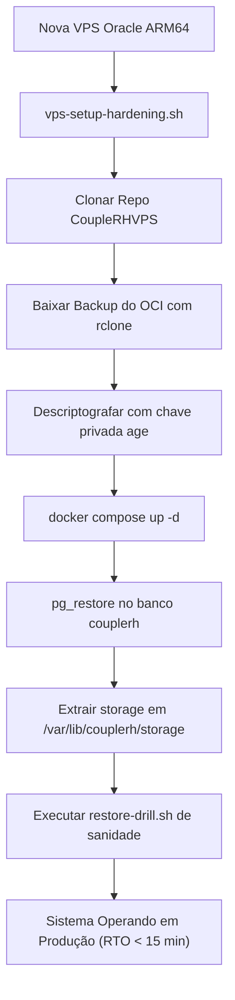

# Estratégia de Backup 3-2-1 e Disaster Recovery (DR) — CoupleRH Enterprise

Este documento estabelece o Procedimento Operacional Padrão (SOP) para salvaguarda, criptografia, sincronização off-site e teste contínuo de restauração de dados do **CoupleRH Enterprise** na VPS Oracle Cloud Always Free (ARM64).

---

## 1. Princípios da Regra de Ouro 3-2-1

Em sistemas de Recursos Humanos e Folha de Pagamento em conformidade com a CLT e LGPD, a integridade e disponibilidade dos dados são críticas:

1. **3 Cópias dos Dados:**
   - **Cópia 1 (Produção):** Dados ativos no PostgreSQL 17 (`/var/lib/couplerh/pgdata`) e Storage de Documentos (`/var/lib/couplerh/storage`).
   - **Cópia 2 (Local Seguro):** Dumps diários compactados e criptografados em volume isolado na própria VPS (`/var/lib/couplerh/backups`, com retenção rotativa de 7 dias).
   - **Cópia 3 (Externa / Off-Site):** Cópia remota sincronizada no **OCI Object Storage Always Free** (20 GB inclusos na Oracle Cloud).

2. **2 Tipos de Mídia Diferentes:**
   - Block Storage NVMe / SSD local da VPS.
   - Object Storage em nuvem distribuída (S3-compatible API da Oracle Cloud).

3. **1 Cópia Remota e Imutável:**
   - Backup off-site geograficamente isolado, prevenindo perda catastrófica mesmo em falha total do data center da VPS.

---

## 2. Criptografia de Ponta a Ponta com `age` (Actually Good Encryption)

Os backups contêm informações sensíveis (PII, contratos, salários, espelhos de ponto e documentos médicos). Por essa razão, nenhum arquivo é enviado à nuvem em texto claro.

### 2.1 Por que `age` em vez de GPG?
- Algoritmos modernos de alta segurança: **ChaCha20-Poly1305** e chaves curvas **X25519**.
- Arquitetura limpa, sem dependências legadas, sem complexidade de Web of Trust.
- Suporte nativo a binários estáticos para arquiteturas **ARM64 (aarch64)** e x86_64.

### 2.2 Gerando as Chaves Criptográficas
Na máquina de gestão ou na VPS:

```bash
# 1. Instale o utilitário age
sudo apt-get install -y age

# 2. Gere o par de chaves mestre
mkdir -p /etc/couplerh
chmod 0700 /etc/couplerh
age-keygen -o /etc/couplerh/backup-age-key.txt
chmod 0600 /etc/couplerh/backup-age-key.txt

# 3. Extraia a chave pública (para criptografia automática)
grep 'public key:' /etc/couplerh/backup-age-key.txt | cut -d: -f2 | xargs > /etc/couplerh/backup-age-public.key
chmod 0644 /etc/couplerh/backup-age-public.key
```

> **IMPORTANTE — SEPARAÇÃO DE PRIVILÉGIOS:**
> A chave pública (`backup-age-public.key`) é usada pelo script `backup.sh` para **criptografar**. O script de backup **NÃO precisa da chave privada** para proteger os dados. Guarde a chave privada (`backup-age-key.txt`) fora da VPS (em um gerenciador seguro de senhas ou cofre institucional). Ela só é necessária em caso de restauração real de desastre ou no drill com chave autorizada.

---

## 3. Configuração do `rclone` com OCI Object Storage

O `rclone` sincroniza os arquivos criptografados para o bucket de 20 GB Always Free da Oracle.

### 3.1 Criar Credenciais S3 no Painel da Oracle Cloud
1. Acesse o **Oracle Cloud Console** → Perfil de Usuário → **Customer Secret Keys**.
2. Clique em **Generate Secret Key** com o nome `rclone-couplerh`.
3. Guarde o **Access Key** e o **Secret Key** gerados.
4. Identifique o seu **Object Storage Namespace** (visível na página de detalhes de Tenancy).

### 3.2 Configurar o Remote no rclone
Execute na VPS:
```bash
sudo apt-get install -y rclone
rclone config
```

Ou crie diretamente o arquivo `/root/.config/rclone/rclone.conf`:
```ini
[oci-couplerh]
type = s3
provider = Other
env_auth = false
access_key_id = <SEU_ACCESS_KEY>
secret_access_key = <SEU_SECRET_KEY>
region = sa-saopaulo-1
endpoint = https://<SEU_NAMESPACE>.compat.objectstorage.sa-saopaulo-1.oraclecloud.com
acl = private
```

Crie o bucket no OCI (se ainda não existir):
```bash
rclone mkdir oci-couplerh:couplerh-backups
```

---

## 4. Scripts e Agendamento Automático

Os scripts de automação residem em `docker/scripts/`:

| Script | Função | Frequência Recomendada |
| :--- | :--- | :--- |
| `docker/scripts/backup.sh` | Gera dump `pg_dump -Fc` do PostgreSQL, compacta `/var/lib/couplerh/storage`, criptografa com `age`, gera hash SHA-256 e sincroniza via `rclone`. | A cada 6 horas (`0 */6 * * *`) |
| `docker/scripts/restore-drill.sh` | Restaura o dump mais recente em banco temporário isolado (`couplerh_restore_drill_*`), valida 5 checagens críticas de consistência e schema, e remove o banco temporário. | Semanal (`0 3 * * 0`) |
| `docker/scripts/setup-backup-cron.sh` | Copia os scripts para `/var/lib/couplerh/scripts` e configura o agendamento no `/etc/cron.d/couplerh-backup`. | Executado no setup |

### Instalação dos Agendamentos:
```bash
sudo bash docker/scripts/setup-backup-cron.sh
```

---

## 5. Simulação Periódica de Restauração (Restore Drill)

A integridade do backup é comprovada periodicamente pelo `restore-drill.sh`:

```bash
sudo /var/lib/couplerh/scripts/restore-drill.sh
```

### O que o teste valida:
- [x] Extração e integridade binária do arquivo `.dump` (ou descriptografia correta se `.age`);
- [x] Restauração do schema em banco PostgreSQL 17 temporário;
- [x] Verificação de presença e consistência das **>= 50 tabelas de negócio**;
- [x] Presença de empresas (`tenants`), colaboradores (`contracts`) e contas (`users`);
- [x] Integridade estrita da trilha imutável `audit.logs`;
- [x] Presença de parâmetros tributários oficiais 2026 (`inss_parameters`, `irrf_parameters`).

---

## 6. Procedimento de Disaster Recovery (DR)

Caso ocorra um desastre total (corrupção irreversível ou exclusão acidental da VPS):



### Passo a Passo de Recuperação:
1. **Provisionar nova VPS** e executar o script de hardening:
   ```bash
   sudo bash docker/scripts/vps-setup-hardening.sh
   ```
2. **Baixar o backup mais recente do Object Storage:**
   ```bash
   rclone sync oci-couplerh:couplerh-backups /var/lib/couplerh/backups --progress
   ```
3. **Descriptografar o dump do banco e o storage com sua chave mestra:**
   ```bash
   age -d -i /caminho/backup-age-key.txt /var/lib/couplerh/backups/couplerh_db_LATEST.dump.age > /tmp/couplerh_db.dump
   age -d -i /caminho/backup-age-key.txt /var/lib/couplerh/backups/couplerh_storage_LATEST.tar.gz.age > /tmp/couplerh_storage.tar.gz
   ```
4. **Subir os contêineres limpos:**
   ```bash
   cd /opt/couplerh/docker
   docker compose up -d
   ```
5. **Restaurar o banco e os arquivos:**
   ```bash
   # Restaura banco
   cat /tmp/couplerh_db.dump | docker exec -i couplerh-db pg_restore -U postgres -d couplerh --clean --if-exists --no-owner --role=couplerh_app

   # Restaura storage
   tar -xzf /tmp/couplerh_storage.tar.gz -C /var/lib/couplerh/storage
   ```
6. **Validar:**
   ```bash
   curl -s http://localhost/health | jq
   ```
   **Tempo Estimado de Recuperação (RTO):** inferior a 15 minutos.  
   **Perda Máxima de Dados (RPO):** no máximo 6 horas.
