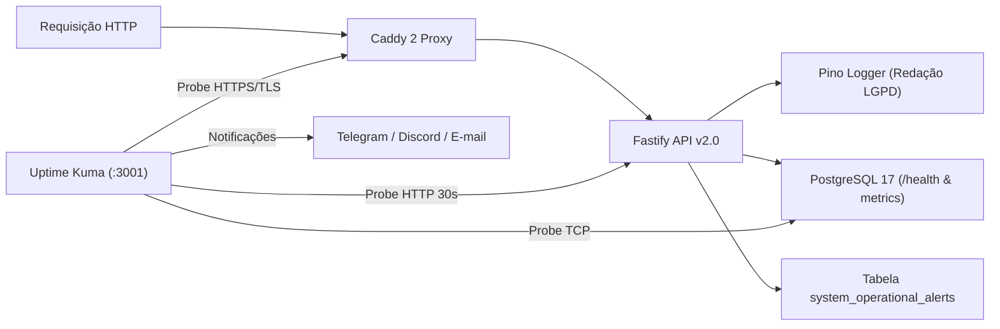

# Guia de Observabilidade, Sanitização LGPD e Monitoramento — CoupleRH Enterprise

Este documento detalha a arquitetura de observabilidade, registro de logs em conformidade com a LGPD, rotação de arquivos e monitoramento de infraestrutura do **CoupleRH Enterprise** na VPS Oracle Cloud Always Free (ARM64).

---

## 1. Visão Geral da Arquitetura

O sistema de observabilidade foi projetado com o princípio de **alta visibilidade com pegada mínima de memória (< 150 MB RAM total)**:



---

## 2. Sanitização Rigorosa de Logs — Conformidade LGPD (Lei 13.709/2018)

Em cumprimento aos artigos 5º e 11 da LGPD (dados pessoais e dados pessoais sensíveis), o servidor **Pino** mascara automaticamente em tempo de execução qualquer informação sensível trafegada nas requisições.

### 2.1 Campos Sanitizados (`[DADO PROTEGIDO LGPD]`):
- **Segurança e Acesso:** `password`, `currentPassword`, `newPassword`, `token`, `accessToken`, `refreshToken`, `totpSecret`, `totpCode`, cabeçalhos `Authorization` e `Cookie`.
- **Identificação Civil (PII):** `cpf`, `pis`, `pis_pasep`, `rg`, `cnh`.
- **Saúde e Medicina Ocupacional:** `cid`, `cid10`, `medicalDiagnosis`.
- **Dados Financeiros e Salariais:** `baseSalary`, `base_salary`, `bankAccount`, `pixKey`.

Mesmo que um desenvolvedor registre `request.body` em log, o motor do Pino substitui os dados pelo valor `[DADO PROTEGIDO LGPD]` antes de qualquer gravação em disco ou saída para o terminal.

---

## 3. Rotação de Logs do Docker (Prevenção de Estouro de Disco)

Para proteger os 200 GB SSD da VPS contra saturação por logs acumulados de contêineres, todos os serviços do `docker-compose.yml` contam com limitação estrita de volume:

```yaml
logging:
  driver: "json-file"
  options:
    max-size: "50m"  # Tamanho máximo de 50 MB por arquivo
    max-file: "5"    # Retenção de no máximo 5 arquivos rotacionados (máx 250 MB por serviço)
```

---

## 4. Endpoints de Monitoramento e Saúde (`/health` & `/metrics`)

### 4.1 Probe de Saúde Principal: `GET /health`
Usado pelo Caddy, Docker Healthcheck e Uptime Kuma:

```json
{
  "status": "healthy",
  "system": "coupleRH Enterprise API",
  "version": "2.0.0",
  "node_env": "production",
  "timestamp": "2026-11-23T14:00:00.000Z",
  "uptime_seconds": 18240,
  "checks": {
    "database": {
      "status": "healthy",
      "latency_ms": 1.2
    },
    "memory": {
      "heap_used_mb": 48,
      "heap_total_mb": 72,
      "rss_mb": 110,
      "free_system_ram_mb": 18450
    }
  }
}
```

- **Status `healthy`:** Retorna código HTTP 200 quando o banco de dados PostgreSQL responde normalmente.
- **Status `degraded`:** Retorna código indicativo caso o banco falhe ou fique inalcançável.

### 4.2 Métricas de Sistema: `GET /api/v1/system/metrics`
Disponibiliza métricas detalhadas do pool de conexões do PostgreSQL (`total_clients`, `idle_clients`, `waiting_clients`), uso de heap da V8 e métricas do hospedeiro.

---

## 5. Tabela de Alertas Operacionais (`system_operational_alerts`)

Criada na migration `0003_system_operational_alerts.sql`, registra anomalias operacionais e eventos de segurança detectados pela aplicação:

- **Severidades:** `INFO`, `WARNING`, `ERROR`, `CRITICAL`.
- **Categorias:** `DATABASE`, `STORAGE`, `QUEUE`, `AUTH`, `BACKUP`, `SYSTEM`, `SECURITY`.
- **Endpoints de Gestão:**
  - `GET /api/v1/system/alerts`: Lista alertas operacionais não resolvidos.
  - `POST /api/v1/system/alerts/:id/resolve`: Marca incidente como resolvido com registro de data/hora.

---

## 6. Painel de Monitoramento com Uptime Kuma

O **Uptime Kuma** roda em contêiner dedicado (`couplerh-uptime-kuma`), consumindo aproximadamente **~80 MB de memória RAM**, exposto na porta `3001` (ou protegido via Caddy):

### 6.1 Probes Recomendadas no Painel:
1. **API Fastify:**
   - Tipo: `HTTP(s)`
   - URL: `http://couplerh-api:4000/health`
   - Intervalo: `30 segundos`
   - Resposta esperada: `200` contendo `"status":"healthy"`
2. **Frontend React SPA:**
   - Tipo: `HTTP(s)`
   - URL: `https://app.couplerh.com.br/`
   - Validação de Certificado TLS: `Ativada` (alerta antes da expiração ACME)
3. **PostgreSQL 17:**
   - Tipo: `TCP Port`
   - Host: `couplerh-db`
   - Porta: `5432`

### 6.2 Canais de Alerta Suportados:
- Bot do Telegram (notificações imediatas no smartphone da equipe de engenharia);
- Webhook Discord / Slack;
- E-mail SMTP de emergência via `MailerService`.
